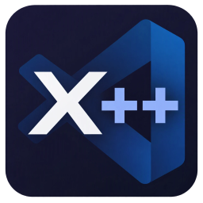

# X++ Tools




Syntax highlighting and formatting for **Dynamics 365 Finance & Operations X++** in Visual Studio Code.

## Features

### `.xpp` files (language `X++`)
- Highlighting for keywords (case-insensitive), the X++ SQL dialect (`select`, `while select`, `firstonly`, `exists join`, `update_recordset`, …),
  `ttsbegin/ttscommit`, attributes (`[ExtensionOf(classStr(X))]`), labels (`"@SYS12345"`, `"@Model:Label"`),
  `strFmt` placeholders, verbatim strings (`@"..."`), date literals (`31\12\2026`), macros (`#define`, `#localmacro`, `#MyMacro`),
  static/enum access (`NoYes::Yes`, `Global::info()`), intrinsic functions (`classStr`, `tableNum`, `fieldStr`, …) and XML doc comments.
- Comment toggling, bracket matching, auto-closing pairs, `/// ` continuation on Enter.

### AOT metadata XML (language `X++ Metadata XML`)
Files matching `**/Ax*/*.xml` (`AxClass`, `AxTable`, `AxForm`, `AxClassExtension`, …) get XML highlighting **plus full X++
highlighting inside `<Source><![CDATA[…]]>` and `<Declaration><![CDATA[…]]>`**. For files in other folders, add
`"files.associations": { "*.xml": "xpp-xml" }` or pick the language from the status bar.

### Formatting (`Shift+Alt+F` / Format Document)
- **X++:** indentation from braces, `switch`/`case` blocks and continuation lines; multi-line `select … where … && …`
  statements keep their alignment; Allman braces (`{` on its own line, `} else` split); spacing around `,` `(` `)`,
  assignment/comparison/logical operators and after `if`/`while`/`for`/`switch`/`catch`. Strings, comments, macros and
  `#localmacro` blocks are never changed.
- **AOT XML:** re-indents the element structure (tabs by default, like the D365 tooling) and formats the embedded X++
  code while keeping the base indentation and blank lines the D365 tools write. Element content and CDATA boundaries are
  never changed, so Visual Studio still reads the files.

The formatter only changes whitespace and is idempotent.

## Settings

| Setting | Default | Description |
|---|---|---|
| `xpp.format.enable` | `true` | Enable the X++ formatter |
| `xpp.format.braceStyle` | `allman` | `allman` or `preserve` |
| `xpp.format.normalizeSpacing` | `true` | Normalize spacing around operators, commas, parentheses |
| `xpp.format.maxBlankLines` | `2` | Max consecutive blank lines |
| `xpp.format.indentCaseLabels` | `true` | Indent `case` labels inside `switch` |
| `xpp.xml.formatEmbeddedCode` | `true` | Format X++ inside `<Source>`/`<Declaration>` CDATA |
| `xpp.xml.formatStructure` | `true` | Re-indent the XML element structure |
| `xpp.xml.embeddedIndentSize` | `4` | Indent size for embedded X++ |

## Installation

Download `xpp-language-tools-<version>.vsix` from the
[latest release](https://github.com/ThomasWilke/VSCodeXPlusPlusTools/releases/latest), then either run
`code --install-extension xpp-language-tools-<version>.vsix` or use **Extensions → … → Install from VSIX…** in VS Code.

## Development

No build step: the extension is plain JavaScript.

```powershell
# run tests (Node, or VS Code's bundled runtime if Node isn't installed)
$env:ELECTRON_RUN_AS_NODE=1; & "$env:LOCALAPPDATA\Programs\Microsoft VS Code\Code.exe" test/run-tests.js --show

# debug: open this folder in VS Code and press F5 ("Run Extension")

# package & install
pwsh ./build-vsix.ps1
code --install-extension .\xpp-language-tools-1.0.0.vsix
```

### Releasing
Bump `version` in `package.json`, add a `CHANGELOG.md` entry, commit, then push a matching tag
(`git tag v1.0.1; git push origin v1.0.1`). The *Release* workflow runs the tests, builds the `.vsix`
with `vsce`, attaches it to a new GitHub Release and publishes it to:

- **VS Code Marketplace** if the repository secret `VSCE_PAT` exists (Azure DevOps personal access token,
  organization *All accessible organizations*, scope *Marketplace → Manage*).
- **Open VSX** if the repository secret `OVSX_PAT` exists (access token from open-vsx.org).

Secrets are added under *Settings → Secrets and variables → Actions*. Without them the workflow only
creates the GitHub Release. The *CI* workflow builds the package with `vsce` on every push to `main`.

